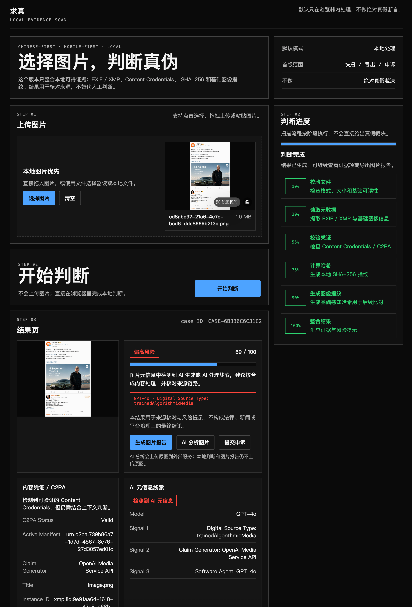

# 求真

一个中文优先、移动端优先的图片真伪风险辅助判断工具。用户上传图片后，应用会先在浏览器本地读取可验证线索，给出风险提示、证据项和 PNG 图片报告；也可以手动触发 AI 图片内容推理，用来识别“一眼假”的截图、海报或新闻主张。

在线体验：<https://really-web-seven.vercel.app/>



## 能做什么

- 本地读取 EXIF / XMP / PNG 基础元信息。
- 检查 Content Credentials / C2PA 内容凭证。
- 计算 SHA-256 和基础图像感知哈希。
- 识别 C2PA / PNG 文本中常见 AI 生成或 AI 处理线索。
- 生成可保存、可转发的 PNG 图片报告。
- 可选 AI 图片分析：上传原图给服务端代理，再由视觉模型根据图片内容做常识和语义一致性推理。

## 重要边界

- 默认判断流程在浏览器本地完成，不上传原图。
- 不输出“百分百真 / 假”裁决，只提供风险提示和可核查依据。
- 没有 EXIF、没有 C2PA 不等于图片异常，只表示可核对信息较少。
- AI 分析是用户主动触发的可选能力，会上传原图到外部 AI 服务。
- AI 分析只作为内容推理参考，不构成事实核验、法律或平台治理结论。

## 判断逻辑

本地判断主要来自规则和证据汇总：

1. 校验文件格式和大小。
2. 读取 EXIF / XMP / PNG 元信息。
3. 检查 Content Credentials / C2PA manifest、actions 和 AI footprint。
4. 计算 SHA-256。
5. 生成基础图像感知哈希。
6. 汇总风险分、风险带、证据项和建议动作。

AI 图片分析不会接收本地 EXIF / C2PA / hash 上下文，只看图片可见内容。它会尝试读取图片里的标题、字幕、人物、品牌、界面和场景关系，并结合常识判断是否存在明显荒诞或不一致的主张，例如“库克加入小米”这类高度可疑内容。

## 技术栈

- Next.js App Router
- React
- TypeScript
- CSS Modules
- Vitest + Testing Library
- `exifr`
- `@contentauth/c2pa-web`
- Web Crypto
- Canvas PNG report

## 本地开发

```bash
npm install
npm run dev
```

打开 <http://localhost:3000>。

常用命令：

```bash
npm test
npm run build
```

## AI 分析配置

AI 分析通过服务端 Route 代理调用 AIHubMix，避免在前端暴露 token。

需要配置环境变量：

```bash
AIHUBMIX_API_KEY=your_api_key
AIHUBMIX_MODEL=gpt-4o-mini
```

`AIHUBMIX_MODEL` 可选，不设置时默认使用 `gpt-4o-mini`。

## 部署

项目可直接部署到 Vercel。

```bash
vercel deploy --prod --yes
```

如果启用 AI 分析，请在 Vercel Project Settings 中配置 `AIHUBMIX_API_KEY`。

## 项目结构

```text
app/
  api/ai-detect/      AI 图片分析服务端代理
  api/appeal/         可选申诉接口
components/          页面组件
lib/scan/            本地扫描流水线
lib/reportImage.ts   PNG 图片报告生成
lib/aiDetection.ts   AI 分析前端请求封装
docs/                README 展示素材
```

## License

暂未声明开源许可证。
